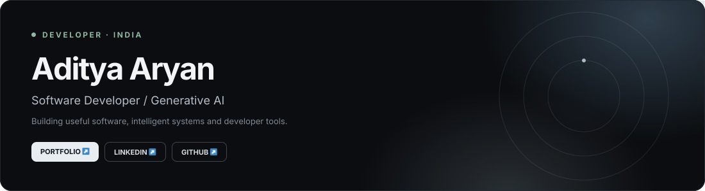
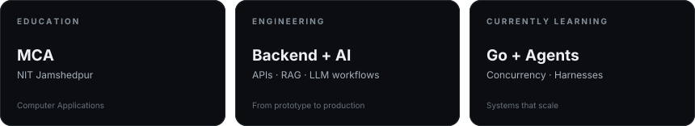
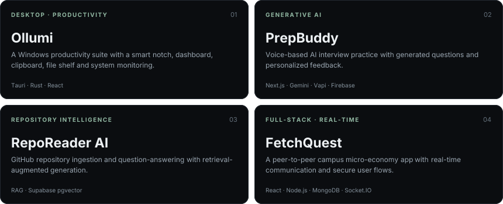
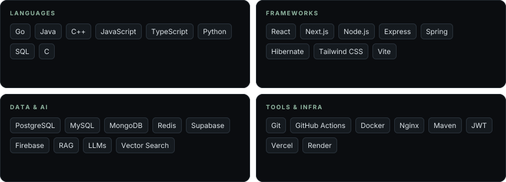
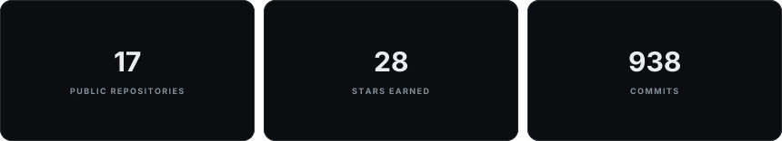
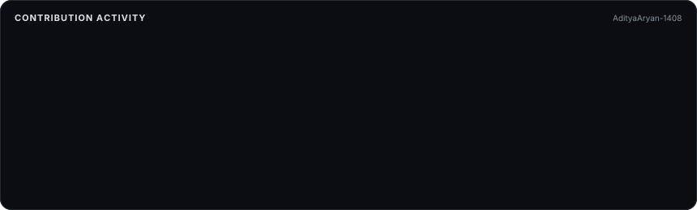

<!-- Aditya Aryan — readme-aura profile
     Edit this file, then run: npx readme-aura build
     GitHub Actions can regenerate README.md when this source changes.
-->

## About

I'm an MCA student at **NIT Jamshedpur**, based in India, working across web development, backend engineering and Generative AI.

I enjoy turning ideas into scalable applications, automating workflows, and building production-minded systems that solve practical problems. My current learning focus is Go, agentic AI, RAG architectures and reliable deployment.

## Selected Projects

## Technology

## Current Focus

* **Go backend engineering** — concurrency, networking, APIs and system design.
* **Agentic AI** — multi-agent systems, tool use and orchestration.
* **AI harness engineering** — building reliable execution environments around AI agents.
* **RAG & LLM systems** — retrieval pipelines, evaluation and practical integrations.
* **DevOps** — containerization, CI/CD, deployment and observability.

## GitHub Activity

## Connect

* **Portfolio:** [aditya-aryan-portfolio.vercel.app](https://aditya-aryan-portfolio.vercel.app/)
* **LinkedIn:** [linkedin.com/in/aryanaditya1408](https://www.linkedin.com/in/aryanaditya1408/)
* **X:** [@AdityaAryan1408](https://x.com/AdityaAryan1408)
* **GitHub:** [@AdityaAryan-1408](https://github.com/AdityaAryan-1408)

***

  Designed with readme-aura · Built with curiosity and shipped with purpose.

