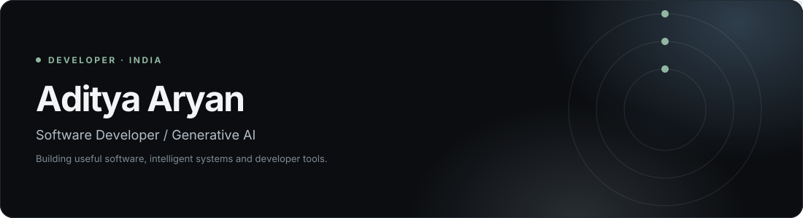
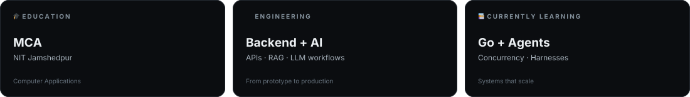
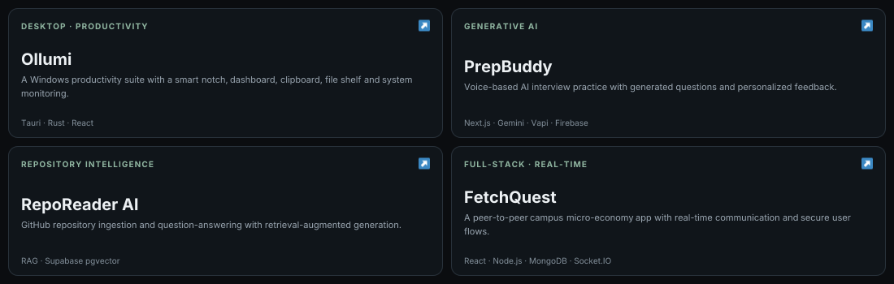
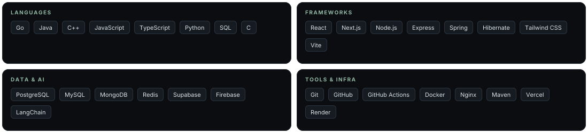
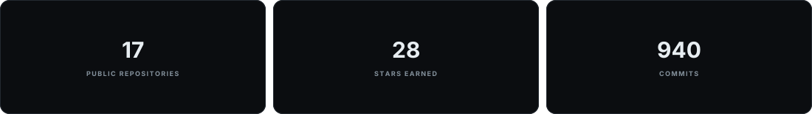

<!--
  Aditya Aryan — readme-aura profile
  Edit this file, then run: npx readme-aura build
-->

## About

I'm an MCA student at **NIT Jamshedpur**, based in India, working across web development, backend engineering and Generative AI.

I enjoy turning ideas into scalable applications, automating workflows, and building production-minded systems that solve practical problems. My current learning focus is Go, agentic AI, RAG architectures and reliable deployment.

**Connect:**

* 🌍 **Portfolio:** : https://aditya-aryan-portfolio.vercel.app/
* 💼 **LinkedIn:** : https://www.linkedin.com/in/aryanaditya1408/

## Selected Projects

## Technology

## Current Focus

* 🐹 **Go backend engineering** — concurrency, networking, APIs and system design.
* 🤖 **Agentic AI** — multi-agent systems, tool use and orchestration.
* 🧰 **AI harness engineering** — building reliable execution environments around AI agents.
* 🧠 **RAG & LLM systems** — retrieval pipelines, evaluation and practical integrations.
* 🚀 **DevOps** — containerization, CI/CD, deployment and observability.

## GitHub Activity

***

  Built with curiosity and shipped with purpose.

